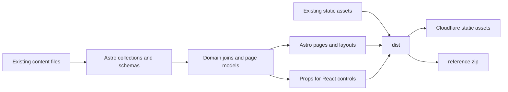

# Gatsby to Astro migration plan

Plan prepared on 2026-10-29. This document proposes the migration; no application code or deployment has changed.

Use Astro to generate the existing site as static HTML, retain React for interactive features, and keep the current content folders and authoring scripts. Deliver the completed migration to Cloudflare after comparison with Gatsby and the live site.

Raphaël confirmed that production has already migrated to Cloudflare. Netlify and S3 references may be stale. Spanish translation was never completed or deployed: retain its source files for future work, with English as the only published locale.

Assume the first release preserves the current design, content, public links, downloads, and interactions. A redesign, new search service, Spanish launch, and server rendering are outside this migration.

## Existing system and compatibility requirements

Gatsby builds a filesystem graph from JSON, MDX, images, PDE, and JavaScript. Templates query that graph for content and relationships; React hooks prepare navigation, code tabs, filters, and localized views. Astro must replace those implicit relationships as well as the page renderer. See the [Gatsby configuration](../gatsby-config.js), [page generator](../gatsby-node.js), [raw-code transformer](../plugins/gatsby-transformer-code/gatsby-node.js), and [hooks](../src/hooks).

The source inventory contains the following route families. These counts describe source definitions, not a verified production build.

| Family | Inventory | Compatibility requirement |
| --- | --- | --- |
| Reference entries | 932 English entries | Preserve reference names, case, underscores, `.html` links, library identity, parent breadcrumbs, code/image pairs, related examples, and sidebars. |
| Examples | 162 English route candidates | Preserve lowercase `.html` links, ordered PDE tabs, live sketches, data assets, related examples, copy, and Open In Processing. |
| Text tutorials | 22 distinct frontmatter slugs | Preserve explicit slugs, custom MDX components, heading anchors, table of contents, covers, and linked files. |
| Core library indexes | 8 distinct names | Preserve `/reference/libraries/{name}/index.html` links and library descriptions. |
| File-based pages | 13 source pages | Include home, reference/examples indexes, environment, overview, people, privacy, donate, tutorials, books, 404, 429, and `/test`. Review existing utility routes before removing any. |
| Other generated pages | Libraries, tools, download, releases | Preserve catalog ordering, selected releases, release assets, and platform controls. |
| Non-page outputs | `/download/latest.txt`, `reference.zip` | Preserve observed contents and consumers, not just filenames. |

The route spelling comes from [path helpers](../src/utils/paths.js) and `gatsby-node.js`. Tutorial slugs are not necessarily folder names. Source generation also visits some translated MDX files twice; generate one English route per identity rather than reproducing duplicate build calls.

Keep reference generation and example synchronization compatible with the existing [reference](reference.md) and [example](examples.md) workflows. Do not rewrite upstream-generated JSON or PDE into a new authoring format. Preserve `static/livesketch/` and `static/livesketch-manual/` paths used by browser examples.

The local `public/` and `.cache/` contain development artifacts, not a usable production baseline. This planning work did not run a production build or measure performance.

## Target architecture

Follow the supplied [Gatsby migration guide](https://docs.astro.build/en/guides/migrate-to-astro/from-gatsby/) for Astro page/layout conversion, React reuse, MDX integration, and removal of Gatsby GraphQL queries. Keep the application statically generated; Cloudflare continues to serve the resulting files.



| Proposed module | Responsibility |
| --- | --- |
| `src/content.config.ts` | Load JSON/MDX from existing folders, validate source shapes, and assign explicit IDs. |
| `src/content/reference.ts` | Own reference identity, parent/category joins, sidebars, code/image pairs, and reverse featured-example links. |
| `src/content/examples.ts` | Own example identity, PDE ordering, live source, data-file mapping, covers, and related cards. |
| `src/content/editorial.ts` | Prepare MDX pages, tutorials, books, library descriptions, and catalog content. |
| `src/content/downloads.ts` | Select local release records and preserve the `latest.txt` contract. |
| `src/utils/paths.*` | Keep one set of public path rules shared by generated routes and links. Migrate existing script callers together if its module format changes. |
| `src/pages/`, `src/layouts/` | Generate routes, document metadata, and static page markup. |
| `src/components/` | Provide MDX mappings, reusable presentation, and bounded React interactions. |
| Asset/build scripts | Emit raw downloadable files and the archive, with collision checks against generated pages and static inputs. |

Collections can read existing JSON and MDX outside `src`. Override generated collection IDs to preserve case and distinguish domain, library, filename, and source locale. Public URLs remain separate from storage IDs. Load array-shaped datasets with an appropriate parser or loader rather than assuming every JSON file is one record. [Astro content collections](https://docs.astro.build/en/guides/content-collections/)

The intended callers are small: a reference route asks `referencePages()` for its route and complete reference view; an example route asks `examplePages()` for its route, content, ordered code files, and asset URLs. Templates do not reconstruct relationships. These illustrative contracts remain unimplemented:

```text
PublishedLocale = "en"
ContentKey = { domain, library?, name, sourceLocale }
CodeFile = { name, source }
Asset = { sourceFile, publicPath }
ReferencePage = { path, reference, parent?, sidebar, examples, code, images }
ExamplePage = { path, description, code, data, cover, liveSketch?, related }

referencePages(): Promise<readonly ReferencePage[]>
examplePages(): Promise<readonly ExamplePage[]>
```

Validate input shapes and relationships at the content boundary, with errors naming source files. Build indexes for the actual joins rather than repeatedly scanning all content. Do not recreate Gatsby File nodes or a general-purpose graph API. Keep raw code and the full content index out of browser props unless that feature needs them.

Render document structure and content with Astro. Reuse stateful React features such as the homepage editor, filter lists, code controls, and release selectors. Rename retained JSX-bearing `.js` components to `.jsx`. Hydrate each feature deliberately; static React rendering alone does not enable event handlers. Keep context-dependent controls in one React subtree, and replace document-wide active-heading/header tracking with one document controller. Astro-rendered MDX is not a React-context descendant of a separate island. [Astro framework components](https://docs.astro.build/en/guides/framework-components/)

Use ordinary document navigation initially. Verify back/forward behavior, anchors, focus, scroll, and saved state. Preserve p5 1.4.0 behavior during migration; make its loading, initialization, errors, timers, and teardown explicit. Treat a p5 upgrade as separate work.

## Implementation sequence

Each phase ends in evidence that the next phase can rely on. Develop in an isolated migration branch/worktree and keep the current deployed version available. The production workflow deploys pushes to `main`, so merge only when ready for the production switch.

| Phase | Work | Exit condition |
| --- | --- | --- |
| 1. Capture the baseline | Produce a clean Gatsby artifact from a recorded revision/runtime/lockfile. Capture the live Cloudflare route responses, screenshots, metadata, content, downloads, and interaction behavior. Record existing failures separately. | A reusable comparison manifest and representative browser fixtures exist. Build failures have a diagnosis; partial dev output is not substituted for a baseline. |
| 2. Establish Astro | Pin compatible Astro, React, MDX, and Node versions. Align `.nvmrc`, build CI, and maintenance CI where appropriate. Configure static output, assets, styles, and a minimal layout. | The minimal site builds reproducibly and serves through local Wrangler with root, directory, `.html`, missing-page, and static-file probes. |
| 3. Prove the hard cases | Port a method reference with parent/in-use/code/image joins, a live example with multiple PDE/data files, and a rich MDX tutorial. Include library index and download artifact probes. | Data, rendering, browser behavior, and HTTP route comparisons pass. Resolve the architectural gaps before bulk conversion. |
| 4. Port all content families | Complete domain loaders and joins, then reference/library pages, examples, tutorials/editorial content, catalogs, downloads/releases, and remaining fixed pages. Convert the shared shell and browser features alongside their first consumers. | Every baseline route has matching intended content or an explicit reviewed difference; links and referenced assets resolve. Spanish content remains retained and unpublished. |
| 5. Verify the complete artifact | Run the route/content comparison, targeted browser tests, responsive/accessibility checks, download checks, and archive checks. Compare build output and browser payloads with Gatsby on equivalent inputs. | No unexplained route, content, asset, or interaction regressions. Record measured results without promising a speedup in advance. |
| 6. Switch and retire Gatsby | Update the production build/output consumers together, publish the verified artifact through the existing Cloudflare workflow, smoke-test production, then complete obsolete-code/documentation cleanup. | Production smoke checks pass, rollback is available, and Gatsby imports, plugins, configuration, and dependencies are removed from the final application. |

Phase 2 should use `publicDir: './static'` and `outDir: './dist'`. This retains authoring paths used by update scripts and prevents confusing Gatsby's generated `public/` with Astro's default asset input. Set `build.inlineStylesheets: 'never'` to preserve the packaging intent of [gatsby-ssr.js](../gatsby-ssr.js). Confirm emitted assets rather than assuming all inlining is controlled by this setting. [Astro configuration](https://docs.astro.build/en/reference/configuration-reference/)

Keep the baseline Gatsby dependency tree separate from the Astro installation. Do not change the root package to ESM without handling the CommonJS maintenance scripts and shared path helper. Astro configuration can use `.mjs` while those scripts retain their current module contract. Do not run content-update scripts as part of migration verification against real sibling repositories; use fixtures where needed.

Port the PostCSS pipeline into explicit configuration, including custom media/properties from `variables.css`, nesting, normalization, and imports. Check CSS Module import semantics, font URLs, SVG component imports, and layout rules that currently target Gatsby wrapper IDs.

Compile the full MDX corpus early enough to expose syntax/plugin incompatibilities. Supply the component map explicitly when rendering MDX. Preserve `FixedImage`, `Intro`, `HighlightBlock`, `Note`, code/entity rendering, heading IDs, tables of contents, relative images, and linked-file copies. Replace Gatsby image objects with Astro image handling or explicit asset metadata; compare dimensions, responsive output, and alt text. [Astro MDX integration](https://docs.astro.build/en/guides/integrations-guide/mdx/)

## Cloudflare delivery and rollback

Distinguish source links, output filenames, and HTTP behavior. Record status, redirect `Location`, final URL, and declared metadata for `.html` references/examples, library `index.html`, root, directory, slashless, query-string, and unknown routes. Preserve existing working entry links and current canonical behavior unless a change is explicitly accepted.

Cloudflare's default HTML handling can redirect `.html` files to extensionless paths. Setting `html_handling: 'none'` also disables implicit directory indexes. Do not select either mode solely from the source route names. Prove the Astro output layout and Cloudflare configuration together against the baseline matrix; use explicit aliases or narrowly scoped routing only where the matrix requires them. [Cloudflare HTML handling](https://developers.cloudflare.com/workers/static-assets/routing/advanced/html-handling/)

At cutover, change `wrangler.json` to consume `dist/` and change the ZIP script to archive the completed `dist/` tree into `reference.zip` outside that directory. Preserve `download/latest.txt` as a generated text artifact. Configure and verify real 404 responses, rather than an SPA fallback. Audit cache headers and content types for HTML, code/data files, fonts, and images. [Cloudflare static sites and 404 pages](https://developers.cloudflare.com/workers/static-assets/routing/static-site-generation/)

Audit the old Netlify subdomain redirects and 429/rate-limit behavior against current Cloudflare settings and live responses. Record which rules were already migrated, remain necessary, or are obsolete. Remove the Gatsby `/page-data/*` exception when Gatsby traffic is retired. Do not copy Netlify domain redirects or rate-limit syntax into Workers configuration; those need the appropriate Cloudflare rule or implementation. [Cloudflare redirect capabilities](https://developers.cloudflare.com/workers/static-assets/redirects/)

Retain the last successful Gatsby artifact, its Cloudflare deployment/version reference, and matching routing configuration before switching. If route, download, sketch, or asset smoke tests fail, restore that deployment and configuration. A source revert is a secondary recovery path because rebuilding old dependencies may fail. Avoid deploying a mixed Gatsby/Astro output directory.

Update [README](../README.md), [publishing instructions](publish.md), content docs where tooling changes, package scripts, and obsolete Netlify/S3 deployment configuration. Preserve the release-update workflow's content-maintenance purpose; its operation is independent of Gatsby rendering.

## Acceptance checks

| Area | Required evidence |
| --- | --- |
| Routes and content | Compare the complete baseline inventory; preserve reference signatures/descriptions/examples, tutorial anchors, catalog membership/order, metadata, and error statuses. Crawl internal links and local assets. Deduplicate generation without dropping pages. |
| Browser features | Check mobile navigation, sidebar state, heading tracking, local OR-term filters, external Google site search, keyboard/focus behavior, tabs/copy, saved homepage editor state, and donation interactions. |
| Examples and desktop integration | Exercise static covers and live canvases, data-heavy and multi-file examples, page reload/back navigation, p5 errors/cleanup, and the `pde://` payload including absolute data URLs. Verify bytes and filenames, not merely successful clicks. |
| Downloads and analytics | Check selected release/platform links, Fathom pageviews and existing platform goal IDs, post-download donation navigation, and the external banner. Use intercepted requests during automated tests to avoid polluting analytics. |
| Assets and archive | Check image sizes, fonts, SVGs, linked tutorial files, Processing example data, public download URLs, `latest.txt`, archive contents, and externalized CSS. Confirm the archive's actual consumption environment before cutover. |
| Build and delivery | Reproducible install/build, no Gatsby runtime or page-data requests, no secrets/browser-only APIs in build output, local Wrangler response checks, Cloudflare production smoke checks, and an executable rollback procedure. |

Retain existing public download paths or provide explicit compatibility handling. New hashed CSS/JS/image filenames are acceptable when all generated references resolve and no documented download contract relies on the old path.

The archive environment remains unresolved: `file://`, an embedded IDE browser, and local HTTP have different URL and module-loading constraints. Test the real consumer before declaring `reference.zip` compatible. Existing CDN/banner/search dependencies do not demonstrate fully offline support.

## Existing quirks and design decision

Track pre-existing behavior separately from migration failures. In particular, [latest.txt generation](../gatsby-node.js) currently derives `1.5.1` from the first item in [selected releases](../content/download/selected.json). Some dotted contribution filenames are interpreted as locale suffixes, and related examples match subcategory without category. Preserve observed output for parity; propose corrections separately with explicit expected changes. Do not carry these accidental naming rules into new content IDs.

The architecture comparison considered retaining large React page trees behind Astro wrappers and introducing a precompiled framework-neutral content manifest. Large wrappers still require replacing Gatsby queries, images, MDX, and routing while retaining broad hydration. A separate content compiler adds another artifact and invalidation path without a demonstrated consumer. The chosen design keeps relationship policy in small domain modules and uses Astro's existing content/MDX pipeline.

All three design candidates favored that direction. The synthesis uses the Astro-native shell and domain modules, adds explicit asset collision checks, and keeps document-wide heading state outside separate React islands. The cost is more initial template conversion in exchange for removing Gatsby-specific dependencies in one migration. The plan was checked against source files, read-only inventory counts, and current official documentation; runtime parity is work for the implementation phases.

The first implementation task is the baseline capture and route-response matrix. The next is the three-case Astro proof, before converting the remaining templates.
